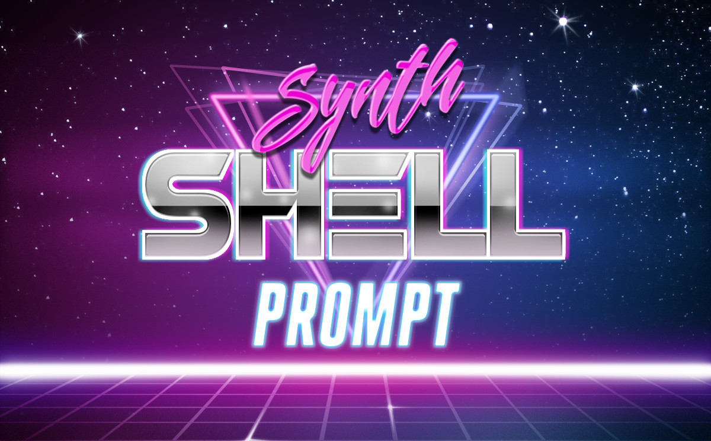
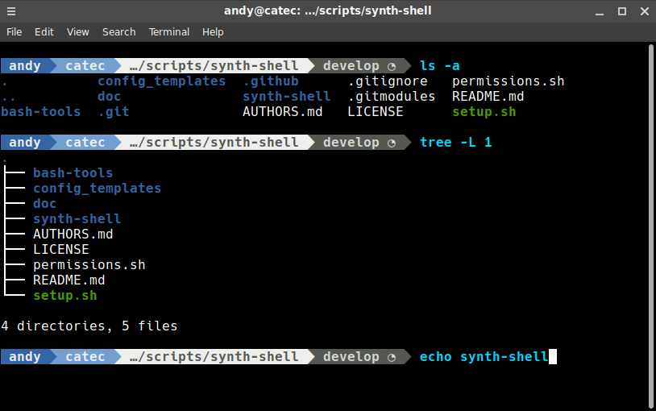

# synth-shell-prompt

[](https://github.com/andresgongora/synth-shell-prompt/releases)
[](LICENSE)
[](https://buymeacoffee.com/andresgongora)

This script is part of [synth-shell](https://github.com/andresgongora/synth-shell).

**synth-shell-prompt** formats your terminal's prompt as shown below. It provides useful information:

- Git statuses (requires pull/push, is dirty, etc.) if inside a directory that is part of a git repository.
- Better separation between user input and command outputs.
- Configurable colors and aesthetics.
- PyEnv aware.
- Intelligent `$PWD` shortening.
- And much more!



<!--------------------------------------+-------------------------------------->
## Install
<!--------------------------------------+-------------------------------------->

### Arch Linux

You may install `synth-shell-prompt` from AUR:
<https://aur.archlinux.org/packages/synth-shell-prompt-git/>

Once installed, test it with:

```bash
. /usr/bin/synth-shell-prompt
```

Add it permanently to your terminal with:

```bash
echo ". /usr/bin/synth-shell-prompt" >> ~/.bashrc
```

### Manual setup

The included [setup script](setup.sh) will guide you step by step through installation. Clone this repository and run it:

```bash
git clone --recursive https://github.com/andresgongora/synth-shell-prompt.git
synth-shell-prompt/setup.sh
```

Install required font packages to display triangle separators properly:

- ArchLinux: `sudo pacman -S powerline-fonts`
- Debian/Ubuntu: `sudo apt install fonts-powerline`

<!--------------------------------------+-------------------------------------->
## Usage
<!--------------------------------------+-------------------------------------->

Test your script by sourcing it from wherever you installed it. Usually this is your user's `.config` folder, so run the following command. Notice the `.`, which sources the script into your terminal session:

```bash
. ~/.config/synth-shell/synth-shell-prompt.sh
```

To make it appear every time you open a new terminal, run:

```bash
echo ". ~/.config/synth-shell/synth-shell-prompt.sh" >> ~/.bashrc
```

`fancy-bash-prompt.sh` adds colors and triangular separators to your bash prompt. If current working directory is part of a git repository, it also shows git statuses and branches. For best results, consider installing and configuring your terminal to use `hack-ttf` alongside `powerline-fonts`, which is required for separators.

For git status info, `fancy-bash-prompt.sh` prints a fourth separator with current branch name and one of following icons to indicate repository state. Icons can be changed in config file.

| Local-Upstream | Local branch has no changes | Local branch is dirty |
| :------------: | :-------------------------: | :-------------------: |
| Up to date | | □ |
| Ahead (you have to push) | ▲ | △ |
| Behind (you have to pull) | ▼ | ▽ |
| Diverged (you have to pull-push) | ● | ○ |

<!--------------------------------------+-------------------------------------->
## Configuration
<!--------------------------------------+-------------------------------------->

Configure scripts by modifying corresponding configuration files. Find them, along with example configuration files, in following folders depending on how you installed **synth-shell**:

- Current-user only: `~/.config/synth-shell/`
- System-wide: `/etc/synth-shell/`

### Command in new line

In addition to having command line right after prompt, configure **synth-shell** to display command on next line:


Change `enable_command_on_new_line=false` to `enable_command_on_new_line=true` in `MAIN FORMAT` section of `synth-shell-prompt.config`.

<!--------------------------------------+-------------------------------------->
## Contributing
<!--------------------------------------+-------------------------------------->

This project is possible thanks to developers, testers, and coffee machine. Find a detailed list of everyone involved in development in [AUTHORS.md](AUTHORS.md).

If you like this project and want to contribute, you are welcome to do so.

### Help us improve

- [Report a bug](https://github.com/andresgongora/synth-shell/issues/new/choose): if something is not right, tell us. We'll try to fix it ASAP.
- Suggest an idea for next release: send an email or open an [issue](https://github.com/andresgongora/synth-shell/issues).
- Become a developer: fork this repo and become an active developer. See [issues](https://github.com/andresgongora/synth-shell/issues) for starting points and [coding style](doc/coding_style.md).
- Spread word: tell friends who might enjoy this code.

<!--------------------------------------+-------------------------------------->
## Donations
<!--------------------------------------+-------------------------------------->

If you like this project and want to show support, [buy me a coffee](https://buymeacoffee.com/andresgongora). Caffeine goes in, code comes out.

<!--------------------------------------+-------------------------------------->
## License
<!--------------------------------------+-------------------------------------->

Copyright (c) 2014-2026, Andres Gongora - www.andresgongora.com

This software is released under the [GNU GPLv3](LICENSE). If the license file is unavailable, see <https://www.gnu.org/licenses/>.

If you need a closed-source version of this software for commercial purposes, contact [authors](AUTHORS.md).
